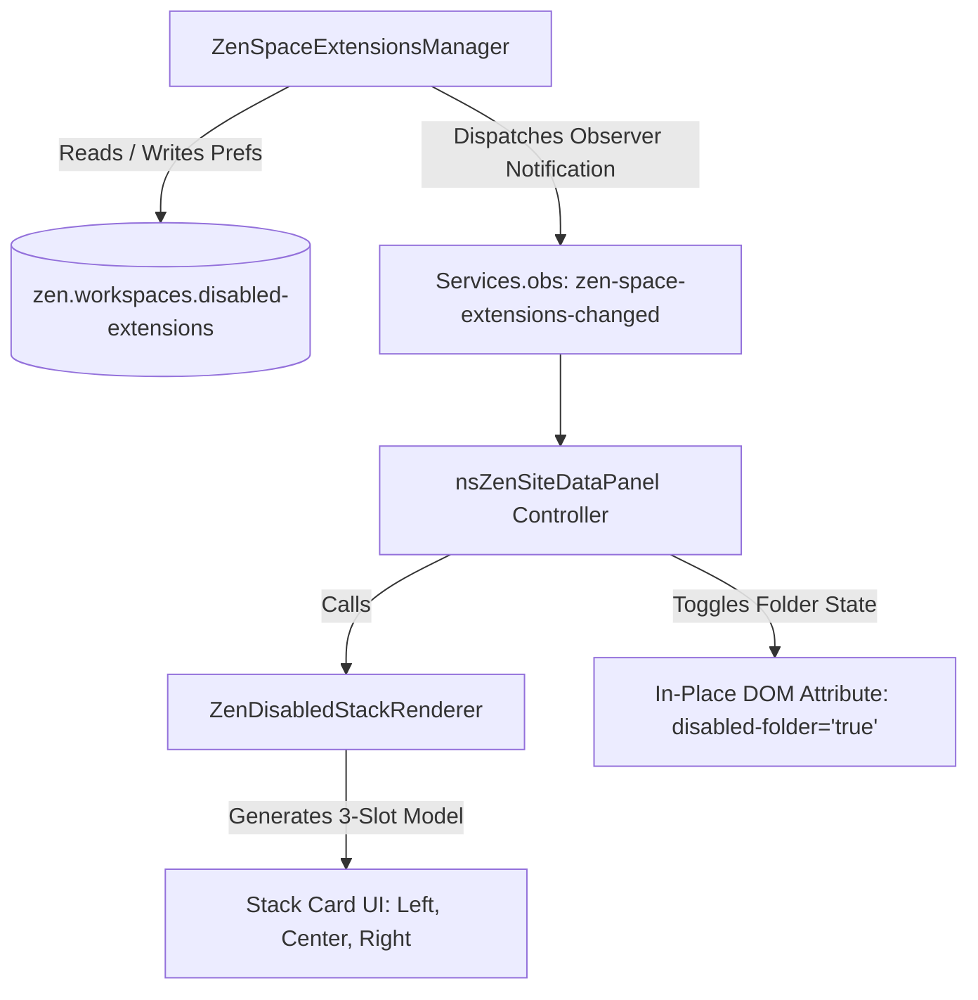

# ADR-001: Per-Space Extension Isolation and Stack Card UI Architecture

## Status
Accepted

## Date
2026-11-14

## Context
Zen Browser organizes user browsing contexts into **Workspaces** (Spaces), allowing distinct tab sets, visual identities, container assignments, and workflows within a single browser window. However, web extensions historically executed globally across all workspaces in the same profile. 

Users required the ability to enable or disable extensions conditionally per workspace (for example, keeping heavy developer tools or security extensions active only in specific work or development spaces, or disabling privacy/adblock extensions in personal spaces where they might conflict).

### Core Requirements
1. **Per-Space Isolation**: Extensions can be disabled on a per-workspace basis without requiring separate Firefox profiles or global toggles.
2. **In-Place Seamless Transition**: When exploring disabled extensions in the Site Data popup, the interface must transition in place—reusing the existing extension grid like opening a folder, rather than launching an external window or detached subview.
3. **Affordance & Visual Hierarchy**: A stack card button representing the disabled extensions within the primary extension grid. It must showcase up to 3 disabled extension icons in an elevated 3-card fan geometry, with graceful placeholder fallback for spaces with 1 or 2 disabled extensions.
4. **Architectural Rigor (SOLID & DRY)**: Decouple domain persistence, stack rendering logic, and panel event lifecycle to ensure future extensibility (such as Gecko-level content script blocking and workspace sync).

---

## Decision

We implement a decoupled, three-tier architecture:

### 1. Domain Service: `ZenSpaceExtensionsManager`
Encapsulates state storage and workspace extension isolation logic following the **Single Responsibility Principle (SRP)**.
- **Storage**: Persists a JSON dictionary mapping workspace IDs to arrays of extension IDs in `zen.workspaces.disabled-extensions`.
- **Query & Mutation API**:
  - `getDisabled(spaceId): string[]`
  - `isDisabled(spaceId, extId): boolean`
  - `disable(spaceId, extId): void`
  - `enable(spaceId, extId): void`
- **Observer Hook**: Dispatches `zen-space-extensions-changed` via `Services.obs` and internal callbacks whenever state mutates, providing an open integration point for runtime behavioral enforcement.

### 2. View Presenter: `ZenDisabledStackRenderer`
Decouples visual geometry and slot allocation from DOM event logic (**Open/Closed Principle**).
- **Slot Distribution Strategy**:
  - **1 Extension**: Center slot contains the active extension icon; Left and Right slots display frosted dashed placeholder slots with generic extension puzzle silhouettes (`chrome://mozapps/skin/extensions/extensionGeneric.svg`).
  - **2 Extensions**: Left and Center slots display active extension icons; Right slot displays the placeholder silhouette.
  - **3+ Extensions**: Left, Right, and elevated Center slots display active extension icons in layered z-index order.
- **Aesthetics**: Cards use `backdrop-filter: blur(12px)`, translucent obsidian surfaces (`rgba(30, 30, 34, 0.62)` back, `rgba(52, 52, 58, 0.82)` front), specular border highlights (`rgba(255, 255, 255, 0.28)`), and centered rotational fanning (`-12deg`, `0deg`, `+12deg`).

### 3. Panel Controller: `nsZenSiteDataPanel`
Coordinates user interactions, folder states, and context menu options.
- **Folder Navigation**: Toggles the `disabled-folder="true"` attribute on the `#zen-site-data-section-addons` container.
- **Header Synchronization**: Replaces the default header with a dedicated space badge showing the active workspace icon/emoji and "Disabled" label.
- **Close Button & Event Suppression**: Transforms the header action button (`#zen-site-data-new-addon-button`) into a close/back button with a 45° rotation and danger red glow. Implements capture-phase suppression and `closemenu="none"` to prevent Firefox's `PanelMultiView` from dismissing the entire popup during folder exit.
- **Quick-Toggle Direct Action (Option A)**: In the Disabled folder, clicking any disabled extension tile intercepts the click/command in capture phase, suppressing the extension popup and immediately re-enabling the extension for the active space. If no disabled extensions remain, the panel seamlessly returns to the main view.
- **Context Menu Integration**: Keeps "Disable on this Space" in the active view, and removes "Enable on this Space" from right-click context menus in favor of the direct quick-toggle interaction model.

---

## Alternatives Considered

### Alternative A: Full Multi-Profile Isolation
- **Description**: Launching separate Firefox profiles or container tabs for each workspace.
- **Drawbacks**: High memory overhead, separated bookmark/history databases, and inability to seamlessly move tabs between workspaces.
- **Rejected**: Too heavyweight and violates Zen's lightweight workspace model.

### Alternative B: `PanelMultiView` Hierarchical Subviews
- **Description**: Utilizing Mozilla's native `<panelmultiview>` sliding subview mechanism (`view-id="zen-disabled-extensions-subview"`).
- **Drawbacks**: Causes horizontal slide animations that disrupt panel layout, resets scroll position, and frequently triggers popup dismissal bugs when navigating between nested views.
- **Rejected**: In-place folder state toggling provides a smoother, native macOS/iOS folder-like mental model.

### Alternative C: Dynamic 1/2/3 Card Fan Geometry
- **Description**: Dynamically resizing or re-angling cards when only 1 or 2 extensions are disabled.
- **Drawbacks**: Resulted in inconsistent visual weight and awkward asymmetrical gaps inside the 44px extension box.
- **Rejected**: Standardized on a 3-card fan geometry at all times, using frosted placeholder silhouettes to maintain visual balance.

---

## Consequences

### Positive
- **Extensible Architecture**: Decoupled `ZenSpaceExtensionsManager` allows background workers or Gecko webRequest filters to inspect workspace permissions without depending on panel UI code.
- **Production-Ready & DRY**: Reusable slot calculation and single-source-of-truth preference management eliminate duplicated card manipulation logic.
- **Cohesive User Experience**: Instant, in-place folder transitions feel like native OS desktop folders.
- **Zero Profile Bloat**: All state is compactly stored in a single JSON preference.

### Positive
- **Instant Visual Distinction**: Pinned toolbar buttons and unified extension entries dynamically hide when switching to spaces where extensions are disabled, giving a distraction-free and accurate workspace view.
- **Deep Context Menu Suppression**: Intercepting `canAccessContext` in Gecko's `ext-menus.js` eliminates clutter and prevents interaction with disabled extensions from the webpage right-click menu.
- **Content Script & DOM Isolation**: Hooking `ExtensionContent.sys.mjs` prevents disabled extensions from injecting scripts, content styles, and sandboxes into tabs belonging to that workspace, directly reducing DOM mutation overhead and improving page load latency.
- **Tab Access Restriction**: Hooking `canAccessTab` in `ext-browser.js` prevents background scripts from querying or messaging tabs in spaces where the extension is marked disabled.
- **Zero CI Wait Time**: Hotpatchable in under 2 seconds on Twilight.app while preserving exact upstream patches in `src/browser/` for production CI builds.
- **Extensible & SOLID Architecture**: `ZenSpaceExtensionsManager` acts as the domain service mediating state and synchronization across parent and child processes.

### Negative & Mitigations
- **Global Extension Background Pages**: Some WebExtension background pages remain loaded globally in the background process.
  - *Mitigation*: Restricting `canAccessTab`, `canAccessContext`, and content script injection cleanly seals off the active workspace's tabs from the background page, ensuring full behavioral and visual isolation without incurring the cost of constant uninstallation/re-installation of add-ons.
