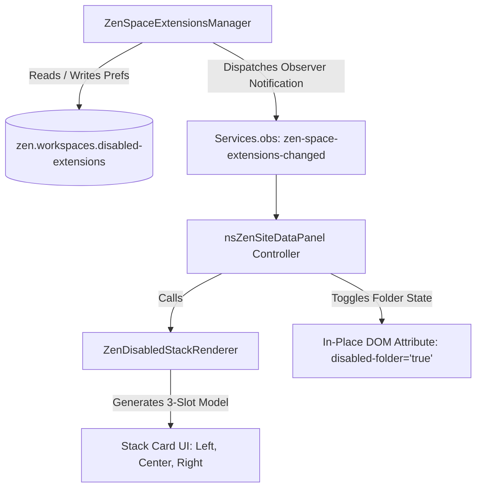

# ADR-001: Per-space extension isolation and stack card UI architecture

## Status

Accepted

## Date

2026-11-14

## Context

Zen Browser splits browsing into workspaces (spaces) with separate tab sets, visual identities, container assignments and workflows in one profile. Web extensions ran globally across all workspaces.

Users wanted extensions enabled or disabled per workspace. Examples: developer tools only in work spaces, or privacy extensions off in personal spaces where they conflict.

### Core requirements

1. Per-space isolation: disable an extension for one workspace without a separate profile or a global toggle.
2. In-place transition: the Site Data popup reuses the extension grid like a folder, with no external window or detached subview.
3. Affordance: a stack card representing disabled extensions in the grid, showing up to 3 icons in a fan, with placeholders for 1 or 2.
4. Decoupled persistence, rendering and panel lifecycle, so Gecko-level blocking and workspace sync can be added later.

---

## Decision

Three tiers:

### 1. Domain service: `ZenSpaceExtensionsManager`

Owns state storage and isolation logic.

- Storage: a JSON dictionary mapping workspace IDs to arrays of extension IDs in `zen.workspaces.disabled-extensions`.
- Query and mutation API:
  - `getDisabled(spaceId): string[]`
  - `isDisabled(spaceId, extId): boolean`
  - `disable(spaceId, extId): void`
  - `enable(spaceId, extId): void`
- Observer hook: dispatches `zen-space-extensions-changed` through `Services.obs` and internal callbacks on every mutation, giving runtime enforcement an integration point.

### 2. View presenter: `ZenDisabledStackRenderer`

Keeps geometry and slot allocation out of DOM event code.

- Slot distribution:
  - 1 extension: center slot holds the icon; left and right show frosted dashed placeholders with `chrome://mozapps/skin/extensions/extensionGeneric.svg`.
  - 2 extensions: left and center hold icons; right shows the placeholder.
  - 3 or more: left, right and elevated center hold icons in z-index order.
- Aesthetics: 18px cards, `backdrop-filter: blur(12px)`, translucent obsidian surfaces (`rgba(30, 30, 34, 0.62)` sides, `rgba(52, 52, 58, 0.82)` center), specular borders (`rgba(255, 255, 255, 0.14)` sides, `rgba(255, 255, 255, 0.28)` center), fan at `-13deg`, raised center, `+13deg`. Hover widens the fan to `18deg`.

### 3. Panel controller: `nsZenSiteDataPanel`

Coordinates interactions, folder state and the context menu.

- Folder navigation: toggles `disabled-folder="true"` on `#zen-site-data-section-addons`.
- Header: replaces the default header with a space badge showing the workspace icon or emoji and a "Disabled" label.
- Close button: turns `#zen-site-data-new-addon-button` into a back button with a 45 degree rotation and danger red glow. Capture-phase suppression plus `closemenu="none"` stops `PanelMultiView` from dismissing the popup when the folder closes.
- Quick toggle: in the folder, a capture-phase click on a disabled tile suppresses the extension popup and re-enables the extension for the active space. When no disabled extensions remain, the panel returns to the main view.
- Context menu: keeps "Disable on this Space" in the normal view and drops "Enable on this Space" in favor of the click action.

---

## Alternatives considered

### A. Full multi-profile isolation

Launch a separate profile or container tab per workspace. Rejected: high memory, split bookmark and history databases, and no seamless tab moves between workspaces.

### B. `PanelMultiView` subviews

Use the native `<panelmultiview>` sliding subview (`view-id="zen-disabled-extensions-subview"`). Rejected: horizontal slide animations disrupt the panel, the scroll position resets, and nested navigation triggers popup dismissal bugs. In-place folder state gives the folder mental model natively.

### C. Dynamic 1/2/3 card fan

Resize or re-angle cards when only 1 or 2 extensions are disabled. Rejected: inconsistent visual weight and awkward gaps inside the 18px box. The design uses a 3-card fan at all times, with placeholders.

---

## Consequences

### Positive

- Decoupled manager: workers or Gecko webRequest filters can inspect workspace permissions without panel code.
- Reusable slot math and one source of truth for the pref remove duplicated card manipulation.
- In-place folder transitions feel like OS folders.
- All state sits in one JSON pref.
- Toolbar buttons and unified extension entries hide on switching to a space where the extension is disabled.
- `canAccessContext` in `ext-menus.js` removes disabled extensions from the page right-click menu.
- `ExtensionContent.sys.mjs` blocks scripts, content styles and sandboxes for disabled extensions, which cuts DOM mutation and page load work.
- `canAccessTab` in `ext-browser.js` stops background scripts from querying or messaging tabs in spaces where the extension is disabled.
- Chrome-side changes can be patched into a built Twilight.app while the upstream patches in `src/browser/` still drive production CI builds.
- After the browser-disabled map is written, the frontmost tab of the changed space reloads immediately and the rest reload on `TabSelect`. Running content scripts stop without a reload burst.

### Negative and mitigations

- Extension background pages stay loaded globally.
  - Mitigation: blocking `canAccessTab`, `canAccessContext` and injection seals the workspace's tabs from the page, with no uninstall or reinstall churn.
